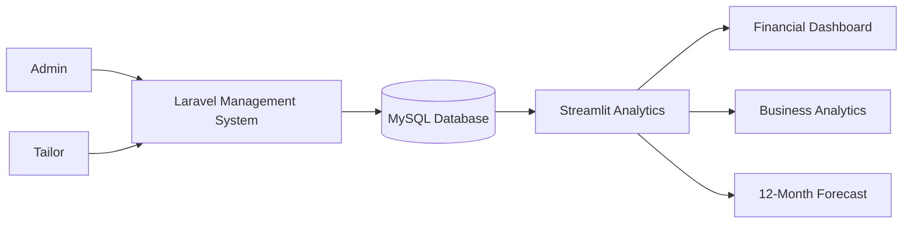
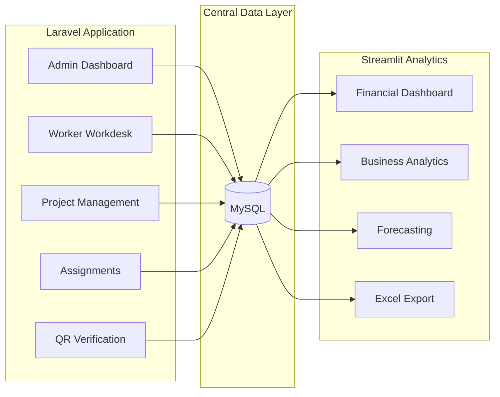
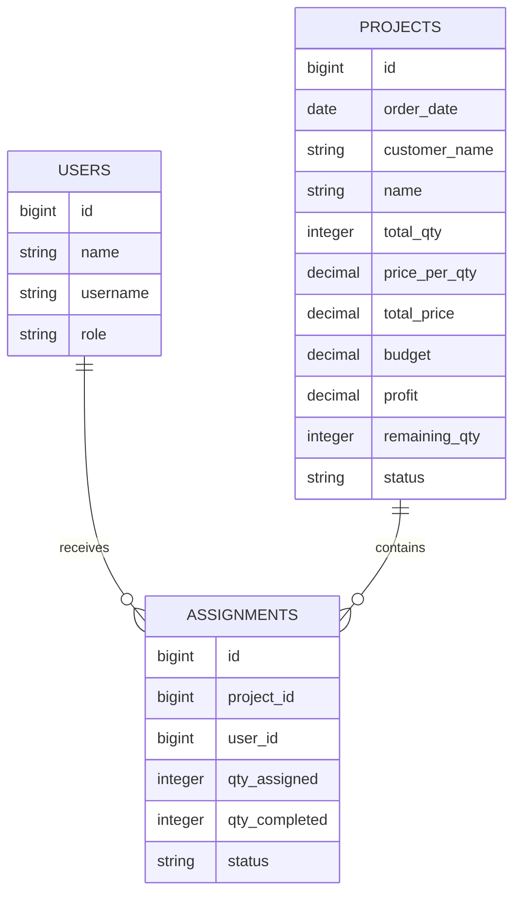

# KSMB Management & Analytics System

> Integrated production management, worker workflow tracking, financial analytics, and forecasting system developed for **Koperasi Sumber Mulia Barokah (KSMB)**.

---

## 📊 Project Highlights

|        **111** |   **35 Months** |    **12 Months** |  **2 Applications** | **1 Database** |
| -------------: | --------------: | ---------------: | ------------------: | -------------: |
| Worker Records | Historical Data | Forecast Horizon | Laravel + Streamlit |          MySQL |

---

## 🏢 Who Is This System For?

**Koperasi Sumber Mulia Barokah (KSMB)** manages sewing and production activities involving multiple workers or tailors.

The organization needs to coordinate:

* 👨‍🔧 Tailor / worker activities
* 📦 Production orders
* 🧵 Sewing assignments
* 🔢 Production quantities
* ✅ Work verification
* 💰 Revenue and profit
* 📊 Historical business performance

As operational activity grows, manually tracking these processes becomes increasingly difficult.

---

# 🎯 The Challenge

KSMB faced several information-management problems.

### 1. Production Flow Was Difficult to Track

Management needed visibility into:

* Who is working on each order?
* How many units were assigned?
* How many units are completed?
* Which assignments are still active?
* Which assignments are waiting for verification?

---

### 2. Worker Assignments Were Difficult to Monitor

The system handles a dataset of:

> **111 worker records**

Without centralized tracking, connecting each worker with their assigned production job becomes difficult.

---

### 3. Remaining Production Quantity Required Manual Tracking

Example:

```text
Production Order
500 pcs
   │
   ├── Tailor A → 100 pcs
   ├── Tailor B → 150 pcs
   └── Tailor C → 100 pcs
                    │
                    ▼
            Remaining: 150 pcs
```

The system automatically maintains the relationship between:

**Total Quantity → Assigned Quantity → Remaining Quantity**

---

### 4. Production Status Was Scattered

Management needed one place to monitor:

```text
Pending
   ↓
Assigned
   ↓
In Progress
   ↓
Checking
   ↓
Completed
```

---

### 5. Financial Data Was Difficult to Interpret

Operational data alone does not answer questions such as:

* How much revenue has been generated?
* How much profit has been earned?
* What is the current profit margin?
* How has performance changed over time?
* What could future sales look like?

---

# 💡 The Solution

The project combines **two interconnected applications**.

| Application   | Responsibility                                  |
| ------------- | ----------------------------------------------- |
| **Laravel**   | Operational and production management           |
| **Streamlit** | Analytics, financial dashboard, and forecasting |

Both applications use:

> **1 centralized MySQL database**

---

## 🔄 Overall System Flow



---

# 🧵 Production Workflow

The system digitizes the production workflow from order creation until completion.

```text
1. Admin Creates Project
            │
            ▼
2. Production Quantity Added
            │
            ▼
3. Quantity Assigned to Tailor
            │
            ▼
4. Tailor Works on Assignment
            │
            ▼
5. Tailor Submits Completion
            │
            ▼
6. Admin Verifies Work
            │
            ▼
         COMPLETED
```

This creates a traceable relationship between:

> **Project → Quantity → Worker → Progress → Verification**

---

# ✨ Key Features

## 👨‍💼 Admin Management

Admin can manage the core operational workflow.

* Admin authentication
* Project management
* Production quantity management
* Worker assignments
* Assignment monitoring
* Remaining quantity tracking
* Production progress tracking
* Work verification
* QR-based worker identification

---

## 🧵 Worker Workdesk

Each tailor receives their own work information.

Workers can:

* View assigned projects
* View assigned quantities
* Monitor active assignments
* Update work progress
* Submit completed work
* Wait for admin verification

---

## 📦 Project Management

Each production project stores information such as:

| Data               | Description                   |
| ------------------ | ----------------------------- |
| Order Date         | Date the order was recorded   |
| Customer           | Customer / client information |
| Project Name       | Product or production project |
| Total Quantity     | Total production quantity     |
| Price / Unit       | Selling price per product     |
| Total Price        | Total project revenue         |
| Budget             | Project budget                |
| Profit             | Estimated / recorded profit   |
| Remaining Quantity | Quantity not yet distributed  |
| Status             | Current project status        |

---

# 📲 QR-Based Worker Identification

Worker identification can be assisted using QR codes.

```text
Scan Worker QR
       │
       ▼
Identify Worker
       │
       ▼
Find Active Assignment
       │
       ▼
Review Completed Quantity
       │
       ▼
Admin Verification
       │
       ▼
Assignment Completed
```

This helps simplify worker lookup when managing more than:

> **100+ worker records**

---

# 📦 Quantity & Stock Visibility

One of the main problems solved by the system is production quantity visibility.

Example:

```text
Project: 500 pcs

Assigned
├── Tailor A → 100 pcs
├── Tailor B → 150 pcs
└── Tailor C → 100 pcs

Total Assigned  → 350 pcs
Remaining       → 150 pcs
```

Management can monitor:

* Total production quantity
* Distributed quantity
* Remaining quantity
* Active assignments
* Completed assignments

---

# 📊 Financial Dashboard

The Streamlit application converts project data into financial insights.

### Main Financial Indicators

| Indicator               | Purpose                    |
| ----------------------- | -------------------------- |
| **Revenue**             | Total project value        |
| **Profit**              | Total project profit       |
| **Profit Margin**       | Profit relative to revenue |
| **Production Quantity** | Total production volume    |
| **Monthly Performance** | Historical business trend  |

---

### Revenue

```text
Revenue = Σ Total Project Value
```

### Profit

```text
Profit = Σ Project Profit
```

### Profit Margin

```text
Profit Margin = Profit / Revenue × 100%
```

---

# 📈 Business Analytics

Historical project data is transformed into management insights.

The dashboard analyzes:

* Revenue trends
* Profit trends
* Production quantity
* Monthly performance
* Historical projects
* Customer orders
* Financial margins
* Future performance projections

---

# 🗓️ Historical Data

The project includes:

> **35 months of historical business data**

Covering:

> **January 2023 → November 2025**

Historical records are used for:

* Financial analysis
* Dashboard visualization
* Business trend analysis
* Forecasting

---

# 🔮 12-Month Forecasting

The analytics system generates:

> **12 months of future projections**

Historical monthly data is processed through regression-based forecasting with trend and seasonal components.

```text
35 Months Historical Data
           │
           ▼
    Monthly Aggregation
           │
           ▼
      Trend Features
           +
    Seasonal Features
           │
           ▼
    Regression Model
           │
           ▼
   12-Month Forecast
```

Seasonality is represented using features such as:

```text
sin(month)
cos(month)
```

The forecasting module is designed as a **decision-support tool**, not a guarantee of future results.

---

# 📥 Excel Reporting

Analytics data can also be exported into Excel.

Useful for:

* Management reports
* Offline analysis
* Financial documentation
* Additional spreadsheet processing

---

# 🏗️ System Architecture



---

# 🔗 Why Laravel + Streamlit?

## Laravel

Used for the transactional and operational system.

```text
Authentication
Worker Management
Project Management
Assignments
Production Tracking
QR Verification
Database Transactions
```

## Streamlit

Used for data processing and analytical workloads.

```text
Data Analysis
Financial Dashboard
Visualization
Forecasting
Excel Reporting
```

### Combined Architecture

```text
Laravel
Operational System
      │
      ▼
    MySQL
      │
      ▼
Streamlit
Analytics System
```

---

# 🛠️ Technology Stack

| Area                 | Technologies          |
| -------------------- | --------------------- |
| Backend              | PHP, Laravel 12       |
| Frontend             | Blade                 |
| Database             | MySQL                 |
| ORM                  | Eloquent ORM          |
| Analytics            | Python, Pandas, NumPy |
| Dashboard            | Streamlit             |
| Machine Learning     | Scikit-learn          |
| Scientific Computing | SciPy                 |
| Visualization        | Plotly, Altair        |
| Reporting            | XlsxWriter            |
| Version Control      | Git & GitHub          |

---

# 🗄️ Database Relationship



---

# 🧩 Problem → Solution

| Problem                                  | Solution                         |
| ---------------------------------------- | -------------------------------- |
| Production flow difficult to track       | Digital production workflow      |
| Worker assignments difficult to monitor  | Individual worker workdesk       |
| Remaining quantity tracked manually      | Automatic quantity records       |
| Worker lookup inefficient                | QR-based identification          |
| Production information scattered         | Centralized management dashboard |
| Financial data difficult to interpret    | Streamlit financial dashboard    |
| Historical data underutilized            | Business analytics               |
| Limited future visibility                | 12-month forecasting             |
| Reporting requires additional processing | Excel export                     |


# 🚀 Running Locally

The system runs as **two applications** connected to the same MySQL database.

```text
Laravel
http://127.0.0.1:8000

Streamlit
http://localhost:8501
```

---

## Laravel

Install dependencies:

```bash
composer install
npm install
```

Create environment configuration:

```bash
cp .env.example .env
php artisan key:generate
```

Configure MySQL:

```env
DB_CONNECTION=mysql
DB_HOST=127.0.0.1
DB_PORT=3306
DB_DATABASE=koperasi_smb
DB_USERNAME=root
DB_PASSWORD=
```

Run migrations:

```bash
php artisan migrate --seed
```

Start Laravel:

```bash
php artisan serve
```

---

## Streamlit

Install Python dependencies:

```bash
pip install streamlit pandas numpy altair mysql-connector-python plotly xlsxwriter scikit-learn scipy
```

Start Streamlit:

```bash
streamlit run app.py
```

---

# 📌 Project Scope Summary

| Metric             |                   Value |
| ------------------ | ----------------------: |
| Worker Records     |                 **111** |
| Historical Dataset |           **35 Months** |
| Historical Period  | **Jan 2023 – Nov 2025** |
| Forecast Horizon   |           **12 Months** |
| Applications       |                   **2** |
| Database           |             **1 MySQL** |
| Main Roles         |                   **2** |
| Analytics Areas    |                   **3** |

---

# 💼 What This Project Demonstrates

### Software Engineering

* Role-based system design
* Relational database modeling
* Production workflow development
* Project and assignment management
* QR-assisted verification
* PHP and Python integration

### Data & Analytics

* Historical data processing
* Financial KPI calculation
* Interactive visualization
* Time-series feature engineering
* Regression-based forecasting
* Excel report generation

### Problem Solving

* Translating a real operational workflow into software
* Connecting production and financial information
* Improving visibility of worker assignments
* Structuring production quantity tracking
* Transforming historical records into business insights

---

# 🎯 Project Impact

The main objective of this project is to improve **operational visibility**.

The system helps management answer questions such as:

* **What projects are currently active?**
* **Who is working on each project?**
* **How many units have been assigned?**
* **How many units remain?**
* **Which assignments are completed?**
* **Which work is waiting for verification?**
* **How are revenue and profit performing?**
* **What do historical trends indicate about future performance?**

---

## Final Scope

**111 workers**
**35 months of historical data**
**12 months of forecasting**
**2 interconnected applications**
**1 centralized database**

> From production-floor activity to management-level financial insights.

---

## ⚠️ Disclaimer

This project was developed based on the operational needs of **Koperasi Sumber Mulia Barokah**.

Sensitive personal or organizational information should be anonymized before publishing the repository publicly.

---

## 👨‍💻 Author

Developed as a full-stack management and business analytics project using:

**Laravel · MySQL · Python · Streamlit**
